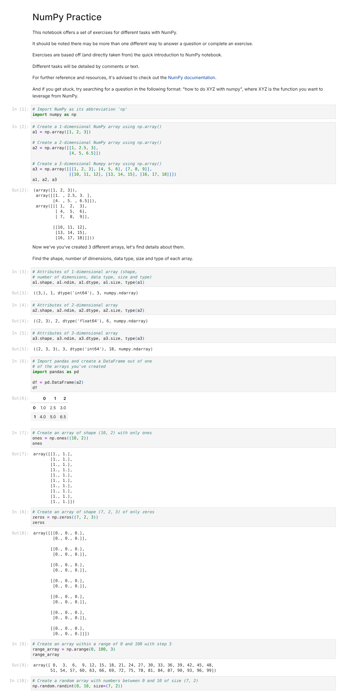
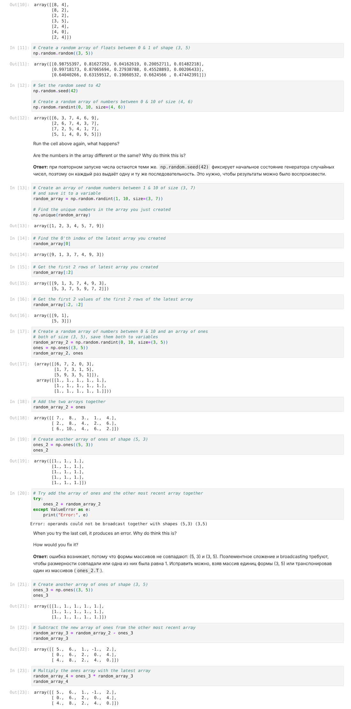
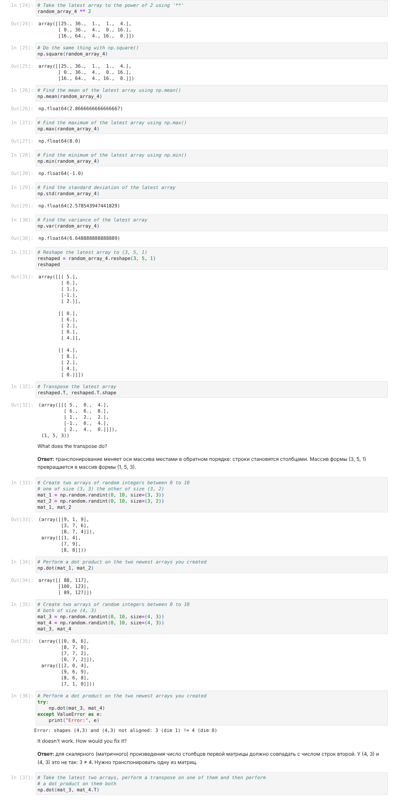
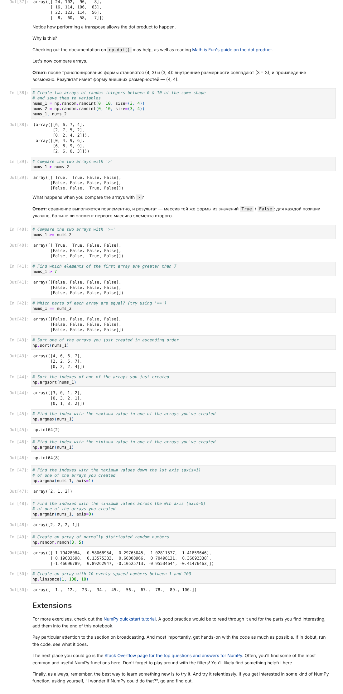

# Лабораторная работа: практика работы с NumPy

## Цель работы
Освоить основные возможности библиотеки **NumPy**: создание массивов разной размерности, изучение их атрибутов, генерацию случайных чисел, индексацию и срезы, арифметические операции и broadcasting, статистические функции, изменение формы, матричное произведение, сравнение и сортировку массивов.

## Структура репозитория
```
├── numpy-exercises.ipynb   # решённый ноутбук с результатами выполнения
├── part1.png … part4.png   # скриншоты работающего ноутбука
└── README.md                # отчёт
```

## Как запустить
```bash
pip install numpy pandas jupyter
jupyter notebook numpy-exercises.ipynb
```

## Выполненные действия

**1. Создание массивов.** Через `np.array()` созданы одномерный, двумерный и трёхмерный массивы.

**2. Атрибуты массивов.** Для каждого массива выведены форма (`shape`), число измерений (`ndim`), тип данных (`dtype`), количество элементов (`size`) и тип объекта (`type`). Из двумерного массива создан `DataFrame` pandas.

**3. Специальные массивы.**
- `np.ones((10, 2))` — массив единиц;
- `np.zeros((7, 2, 3))` — массив нулей;
- `np.arange(0, 100, 3)` — числа от 0 до 100 с шагом 3;
- `np.linspace(1, 100, 10)` — 10 равномерно распределённых чисел от 1 до 100.

**4. Случайные числа.**
- `np.random.randint` — случайные целые числа;
- `np.random.random` — дробные числа от 0 до 1;
- `np.random.randn` — нормальное распределение.

`np.random.seed(42)` фиксирует генератор, поэтому при повторном запуске получаются те же числа.

**5. Индексация и срезы.** `np.unique()` находит уникальные значения. Выбраны нулевая строка, первые две строки и первые два значения первых двух строк (`[:2, :2]`).

**6. Арифметика и broadcasting.** Массивы складываются, вычитаются, умножаются и возводятся в квадрат (`**2`, `np.square`). Сложение массивов форм (3, 5) и (5, 3) вызывает ошибку: формы несовместимы для broadcasting.

**7. Статистика.** Найдены среднее, максимум, минимум, стандартное отклонение и дисперсия (`np.mean`, `np.max`, `np.min`, `np.std`, `np.var`).

**8. Изменение формы.** Массив преобразован в форму (3, 5, 1) через `reshape`. Транспонирование `.T` дало форму (1, 5, 3): оси поменялись местами в обратном порядке.

**9. Матричное произведение.** `np.dot` для матриц (3, 3) и (3, 2) даёт результат формы (3, 2). Для двух матриц (4, 3) произведение невозможно: число столбцов первой матрицы не равно числу строк второй. После транспонирования одной из них получаются формы (4, 3) и (3, 4) и результат формы (4, 4).

**10. Сравнение массивов.** Операторы `>`, `>=`, `==` и сравнение с числом (`> 7`) работают поэлементно и возвращают массив из `True` / `False`.

**11. Сортировка и поиск индексов.**
- `np.sort` — сортировка значений;
- `np.argsort` — индексы, которые отсортировали бы массив;
- `np.argmax` / `np.argmin` — индекс максимума и минимума, в том числе по осям `axis=1` и `axis=0`.

## Скриншоты работоспособности
Ноутбук выполнен полностью. Ячейки, где ошибка ожидается по заданию, обёрнуты в `try/except` и выводят текст ошибки. Ниже — скриншоты всех ячеек с результатами.






## Вывод
В ходе работы освоены создание массивов NumPy и их атрибуты, генерация случайных данных, индексация, поэлементные операции и правила broadcasting. Также отработаны статистические функции, изменение формы, условия выполнения матричного произведения, сравнение и сортировка массивов.
